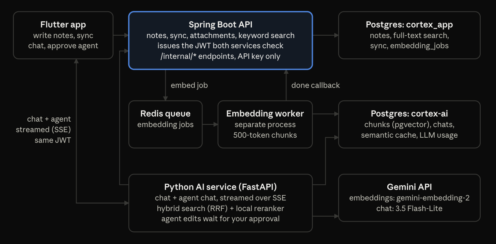

# cortex-ai

The AI service behind [Cortex](https://github.com/abhishekpanja554/cortex), an offline-first notes app you can ask questions about.
A background worker splits notes into chunks and embeds them into pgvector. The API answers questions with hybrid keyword and semantic search, a local reranker, and cited, streamed answers from Gemini.
It also runs an agent that can search, create, update and delete notes, and every destructive action waits for the user's approval.

A demo GIF of the app is in the [Cortex README](https://github.com/abhishekpanja554/cortex#readme).

## Architecture



| Repository | Role |
|---|---|
| [cortex](https://github.com/abhishekpanja554/cortex) | Flutter app: encrypted local database, sync engine, chat and agent UI |
| [cortex_app_be](https://github.com/abhishekpanja554/cortex_app_be) | Auth, notes, sync, attachments, keyword search, embedding jobs |
| **cortex-ai** (this repo) | Embedding worker, hybrid search, reranking, RAG chat and agent |

The service runs as two processes. A crashed worker can't hide behind a healthy `/health`, and a slow embedding batch can't stall chat.

- **Worker** (`app.worker.main`): takes jobs from the Redis list `jobs:embedding`, embeds the note, and calls cortex_app_be back with the result.
- **API** (`app.api.main`): FastAPI app that serves search, chat and the agent.

## How a question is answered

1. **Retrieve.** The question is embedded (`gemini-embedding-2`, 3072 dimensions) and matched against note chunks by cosine distance. In parallel, cortex_app_be runs a Postgres full-text search. Each side returns up to 20 candidates.
2. **Fuse.** Reciprocal Rank Fusion (k = 60) merges the two lists, so a note that ranks well on either side has a chance.
3. **Rerank.** A local cross-encoder (`ms-marco-MiniLM-L-6-v2`) scores each candidate against the question and keeps the top 5.
4. **Generate.** The model gets the sources labelled `[Source n]` and must cite them, or say it can't answer from the notes. The answer streams back over Server-Sent Events.

Around that pipeline:

- **Chunking:** 500 tokens with a 50-token overlap. The note's title is put in front of the body before splitting, and each chunk also stores the title so search results can show it.
- **Vector index:** HNSW on a `halfvec` cast of the column, because pgvector can't index plain `vector` columns over 2000 dimensions.
- **Prompt-injection guard:** source text is treated as untrusted data, and instructions inside notes are ignored. The agent's destructive tools never run without human approval.
- **PII redaction:** emails, phone numbers, SSNs, card numbers and IP addresses are masked in what's sent to the model, not in storage or search.
- **Safety and cost controls:** per-user rate limits (in Redis), an audit log of every LLM call, per-request cost tracking, a semantic cache for repeated questions (15 minutes), and multi-turn chat history.
- **Agent tools:** `search_notes`, `get_note` and `create_note` run immediately. `update_note`, `delete_note` and `bulk_delete_notes` return a confirmation that the app shows as an approval card.

Real bugs found while building it, and how they were fixed, are written up in [docs/FAILURE_MODES.md](docs/FAILURE_MODES.md).

## API

All endpoints except `/health` need the JWT issued by cortex_app_be.

| Method and path | Purpose | Rate limit |
|---|---|---|
| `GET /health` | Liveness | none |
| `POST /search` | Vector search | 30 per minute |
| `POST /hybrid-search` | Vector and keyword search, fused | 30 per minute |
| `POST /chat` | Answer a question from your notes (SSE stream) | 10 per minute |
| `POST /agent-chat` | Agent with note tools (SSE stream) | 10 per minute |
| `POST /agent-chat/confirm` | Approve or reject a pending agent action | 20 per minute |

## Running it locally

You need Python 3.14, [uv](https://docs.astral.sh/uv/), PostgreSQL with the [pgvector](https://github.com/pgvector/pgvector) extension (0.7 or later, for `halfvec`), Redis, and a [Gemini API key](https://aistudio.google.com/apikey). Start [cortex_app_be](https://github.com/abhishekpanja554/cortex_app_be#running-it-locally) first; it also starts Redis.

```bash
createdb cortex-ai
uv sync
cp .env.example .env
```

Fill in `.env`:

| Variable | Value |
|---|---|
| `DB_USER`, `DB_PASSWORD` | Your Postgres login |
| `GEMINI_API_KEY` | Your Gemini key |
| `CORTEX_AI_API_KEY` | Same value as cortex_app_be |
| `JWT_SECRET` | Same value as cortex_app_be |
| `GEMINI_COMPLEX_MODEL` | Model for questions with 3+ sources, e.g. `gemini-3.5-flash-lite` |

Then run the migrations and start both processes, each in its own terminal:

```bash
uv run alembic upgrade head                                  # also enables the vector extension
uv run uvicorn app.api.main:app --reload --host 0.0.0.0      # API on port 8000
uv run python -m app.worker.main                             # embedding worker
```

The first chat request downloads the reranker model (about 90 MB).

Check it's up:

```bash
curl http://localhost:8000/health
```

<!--
## Evaluation

TODO: add once the golden-question set exists.
- Number of questions and how they were written
- Hit rate / MRR before and after the reranker
- Whether it runs in CI
-->

## License

[Apache 2.0](LICENSE)
